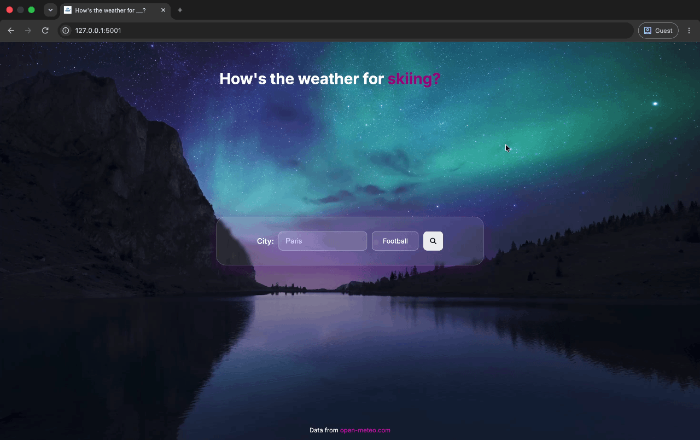

# How's-The-Weather-For?-

### ℹ️ Description:

A minimalist web app that rates the suitability of current weather conditions of different activities for a desired city.

The application is available online: [Live Demo](https://hows-the-weather-for.onrender.com/).

Alternatively, clone the repository, install the dependencies using pip install -r requirements.txt, and run it locally with `python3 app.py`.
## Demo

## Features:
 - Search for cities worldwide using Open-Meteo's Geocoding API.
 - Enter an activity from football, running, golf, basketball and skiing.
 - Retrieve live weather information using Open-Meteo's Forecast API.
 -  The application will generate a score out of 100 depicting the suitablity of the city's weather for the chosen activity
 - The weather score is based on different weightings of variables for each sport, e.g a high humidity is less likely to be disruptive to playing golf than football, hence a lower importance and weighting.
 - The results card will display temperature, wind speed and rainfall.
 - The results card will display a verdict based on the calculated score 
 - A clear button to reset the results card
 - Handle invalid locations and API request failures by returning an appropriate error message.
 - Interactive interface featuring a rolling text animation.

## 🎯 Why I Built This
I built this application because I often found myself searching the weather forecast before undertaking a specific sport to determine if it was a suitable day or not. 

I thought it would be interesting to create an algorithm that takes the weather variables for a location to provide a consistent scoring system for different activities, saving time and reducing uncertainty.

Furthermore, I built this project to develop my Python skills and gain practical experience working with APIs, backend development and web applications.

## How It Works:
The user enters a city and selects an activity.

Flask receives the submitted form data.

The Geocoding API converts the city into latitude and longitude coordinates.

The Forecast API retrieves the current weather conditions.

The appropriate scoring function evaluates temperature, humidity, rainfall, snowfall and wind speed.

The application returns a suitability score between 0 and 100 and displays a verdict.

## Technologies used:
- Python: backend logic and suitability algorithms
- HTML & CSS: page structure, styling and animations
- Open-Meteo API 
- Requests
- Flask
- Jinja2
